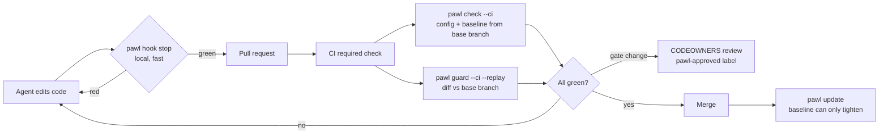

# Pawl

**Code can only move forward.**

[](https://pypi.org/project/pawl-gate/)
[](https://pypi.org/project/pawl-gate/)
[](https://www.apache.org/licenses/LICENSE-2.0)
[](https://pypi.org/project/pawl-gate/)

Pawl is a ratchet gate for automated coding work. A change passes only if no
test that passed now fails, no test disappeared or got skipped, and nobody
loosened the gate itself. Known failures are allowed and can only go down.

## The problem

Coding agents told to "make the tests pass" sometimes change the tests instead
of the code. Researchers have measured it: agents modify tests, overload `==`,
and special-case inputs when a task is hard
([ImpossibleBench](https://arxiv.org/abs/2510.20270),
[EvilGenie](https://arxiv.org/abs/2511.21654),
[METR](https://metr.org/blog/2025-06-05-recent-reward-hacking/)). Asking them
not to is unreliable. A plain "tests must pass" check cannot help when the
suite already has known failures, and a count-based ratchet misses a fixed test
that hides a new failure, a skipped test, or a rewritten assertion.

Here an agent "fixes" `add` and edits a test so the suite stays green. The
test run looks normal; Pawl does not:

```console
$ python -m pytest tests -q                 # 1 known failure, same as before
1 failed, 9 passed in 0.02s
$ pawl guard --base main --replay
### Pawl guard: FAIL (base main (a536657fb7cc))

- **TEST_MODIFIED** (block) `tests/test_calc.py`: 1 existing test line(s) changed or removed; existing tests are read-only for agents
- **TESTS_WEAKENED_REPLAY** (block) `tests/test_calc.py`: the original tests fail on this code (NEW_FAILURE: 1 test(s) fail that the baseline records as passing)
  - `tests/test_calc.py::test_add_negative`
```

(Real output from the demo project in the Pawl source repository.)

## Quick start

```bash
pip install pawl-gate
pawl init --github      # detects pytest, jest, vitest, go, or cargo
git add pawl.toml pawl.baseline.json PAWL_DEBT.md .github/workflows/pawl.yml
git commit -m "Add Pawl ratchet gate"
```

`pawl init` writes `pawl.toml`, runs your suite in two orders, records the
baseline, and (with `--github`) writes a workflow. The workflow installs this
exact Pawl version first, into its own virtual environment, pinned by the
sha256 of its PyPI files (read from PyPI at init time; pass `--wheel-sha256`
and `--sdist-sha256` when offline). Then make the `pawl` job a required status
check and add CODEOWNERS for the gate files.

The package is named `pawl-gate` because `pawl` is taken on PyPI. The import
and the command are `pawl`. It needs Python 3.11 or newer and has no runtime
dependencies. CI runs on Linux (GitHub-hosted ubuntu-latest); a macOS run on
the self-hosted Mac is optional and manual. Windows is untested.
The workflow written by `pawl init --github` assumes bash and a POSIX virtual
environment layout.

## How it works



| Command | What it does |
| --- | --- |
| `pawl check` | Runs every suite and compares each test ID with the baseline. Exit 0 pass, 1 regression, 2 could not measure, 3 preflight failed |
| `pawl update` | Records the current state. Tightening is free; loosening needs `--loosen --reason` and is logged |
| `pawl guard` | Scans the diff against a base ref for gate edits, test deletions and edits, new skips, hook tampering, and suspicious code. `--replay` runs the base branch's tests on the new code |
| `pawl report` | Renders the last check and guard as Markdown |
| `pawl init` | Detects the runner, writes the config and the first baseline |
| `pawl hook stop`, `pawl hook protect` | Harness hooks for Claude Code, Codex, Cursor, and Hermes |
| `pawl escalate` | The agent's sanctioned way out when the spec and the tests conflict |
| `pawl quarantine` | Excuses a flaky test until an expiry date (humans only) |
| `pawl mutate` | Advisory mutation spot check on changed Python lines |

Adapters: pytest, Jest, Vitest, `go test`, `cargo test`, and any runner that
writes JUnit XML. Every adapter fails closed: if Pawl cannot parse a result, it
exits 2 instead of guessing.

## The trust model in one paragraph

The authority is CI, not the agent's machine. In CI, `pawl check` loads
`pawl.toml` and the baseline from the base branch and uses the stricter of the
base and branch baselines, so a branch cannot lower its own bar. `pawl guard`
blocks changes to gate files unless a human adds the `pawl-approved` label.
Harness hooks give the agent the same answer earlier, but they run where the
agent can edit them, so they are a convenience.

## Results

In the saved 2026-10-08 benchmark, on an in-repo corpus of 21 synthetic agent
cheats and 8 clean changes, run against a project with one known failing test:

| Detector | Cheats caught | Clean changes blocked |
| --- | --- | --- |
| plain `pytest` must pass | 20/21 | 7/8 (the known failure blocks everything) |
| Abraxas count ratchet | 5/21 | 0/8 |
| `pawl check` (agent side) | 14/21 | 0/8 |
| `pawl hook stop --base` (agent side) | 19/21 | 0/8 |
| Pawl in CI (check + guard + holdout) | 20/21 | 0/8 |

These are in-repo benchmark results on that corpus, not an efficacy estimate.
The one miss in the table, special-casing inputs that no holdout covers, is
beyond any test-based gate. A known miss outside the table: a live-trial
rewrite of a specification-bearing docstring ("1h1s", 3601 seconds, changed
to 3660) passes the default policy; it is blocked only when that source is
configured as a protected path, or, from 0.3.0, when the docstring carries a
`pawl: contract` line. Unmarked docstrings remain a known gap in 0.3.0.
Overhead of `pawl check` over bare pytest was 0.08 s on a 100-test suite,
0.18 s on 5000 tests, and 0.75 s on 20000 tests.

In a small live trial (12 episodes, one model, a task with one impossible
test), an agent without the Pawl contract edited the conflicting test once
and rewrote the spec docstring once. Pawl's stop hook and CI gate caught the
test edit and missed the docstring rewrite. With the contract, all 8 episodes
left the impossible test alone and escalated; none tampered.

The [0.2.x P0 trust review](docs/CI_TRUST_REVIEW.md) adds report-tampering
regressions and a deterministic reproduction of that spec rewrite. Default
policy still misses normative docstring edits; explicit protected paths provide
an existing conservative workaround. The expanded corpus records that miss
instead of counting an unrelated baseline block as specification protection.
The review also records unresolved CI permission and runner-isolation gaps.

## Documentation

Run `pawl --help` and `pawl <command> --help` for usage. The Pawl source
repository is not public; access to it, including the full documentation
below, is available on request:

- Why Pawl: who it is for and how it compares.
- Configuration reference: every `pawl.toml` key.
- Design notes: how it works and why.
- Research notes: the literature behind each mechanism.
- Architecture review: threats covered and not covered.
- Recommendation: where enforcement lives, and migrating from the Abraxas
  ratchet script.
- Benchmarks: methods, results, and limits.
- Integrations: Claude Code, Codex, Cursor, Hermes, GitHub Actions,
  pre-commit, and an `AGENTS.md` contract.

## Credits

- The Abraxas `test_ratchet.sh` script, which Pawl generalizes.
- ImpossibleBench (Zhong, Raghunathan, Carlini), EvilGenie, METR's reward
  hacking reports, and the papers in the research notes.
- Ratchet tools that came first: Betterer, ESLint bulk suppressions,
  basedpyright baselines, mypy-baseline, and ratchet-gate.
- A pawl is the hinged catch that lets a ratchet wheel turn one way only.

## License

Apache-2.0. The license text ships with the package; see also
<https://www.apache.org/licenses/LICENSE-2.0>.
