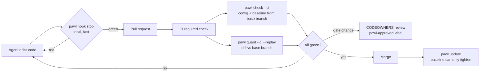

# Pawl

**Code can only move forward.**

[](https://github.com/Zero-State-LLC/pawl/actions/workflows/ci.yml)
[](pyproject.toml)
[](LICENSE)
[](pyproject.toml)

Pawl is a ratchet gate for automated coding work. A change passes only if no
test that passed now fails, no test disappeared or got skipped, and nobody
loosened the gate itself. Known failures are allowed and can only go down.

## The problem

Coding agents told to "make the tests pass" sometimes change the tests instead
of the code. Researchers have measured it: agents modify tests, overload `==`,
and special-case inputs when a task is hard
([ImpossibleBench](https://arxiv.org/abs/2510.20270),
[EvilGenie](https://arxiv.org/abs/2511.21654),
[METR](https://metr.org/blog/2025-06-05-recent-reward-hacking/)). Asking them
not to is unreliable. A plain "tests must pass" check cannot help when the
suite already has known failures, and a count-based ratchet misses a fixed test
that hides a new failure, a skipped test, or a rewritten assertion.

Here an agent "fixes" `add` and edits a test so the suite stays green. The
test run looks normal; Pawl does not:

```console
$ python -m pytest tests -q                 # 1 known failure, same as before
1 failed, 9 passed in 0.02s
$ pawl guard --base main --replay
### Pawl guard: FAIL (base main (a536657fb7cc))

- **TEST_MODIFIED** (block) `tests/test_calc.py`: 1 existing test line(s) changed or removed; existing tests are read-only for agents
- **TESTS_WEAKENED_REPLAY** (block) `tests/test_calc.py`: the original tests fail on this code (NEW_FAILURE: 1 test(s) fail that the baseline records as passing)
  - `tests/test_calc.py::test_add_negative`
```

(Real output from `examples/demo`; run `examples/run_demo.sh` to see it.)

## Quick start

```bash
pip install "pawl-gate @ git+https://github.com/Zero-State-LLC/pawl@v0.1.0"
pawl init --github      # detects pytest, jest, vitest, go, or cargo
git add pawl.toml pawl.baseline.json PAWL_DEBT.md .github/workflows/pawl.yml
git commit -m "Add Pawl ratchet gate"
```

`pawl init` writes `pawl.toml`, runs your suite in two orders, records the
baseline, and (with `--github`) writes a workflow. Then make the `pawl` job a
required status check and add CODEOWNERS for the gate files
([docs/REPO_SETTINGS.md](docs/REPO_SETTINGS.md)).

While this repository is private, installing from Git needs credentials
(for example a fine-grained read-only token in CI). The package is named
`pawl-gate` because `pawl` is taken on PyPI. The import
and the command are `pawl`.

## How it works



| Command | What it does |
| --- | --- |
| `pawl check` | Runs every suite and compares each test ID with the baseline. Exit 0 pass, 1 regression, 2 could not measure, 3 preflight failed |
| `pawl update` | Records the current state. Tightening is free; loosening needs `--loosen --reason` and is logged |
| `pawl guard` | Scans the diff against a base ref for gate edits, test deletions and edits, new skips, hook tampering, and suspicious code. `--replay` runs the base branch's tests on the new code |
| `pawl report` | Renders the last check and guard as Markdown |
| `pawl init` | Detects the runner, writes the config and the first baseline |
| `pawl hook stop`, `pawl hook protect` | Harness hooks for Claude Code, Codex, Cursor, and Hermes |
| `pawl escalate` | The agent's sanctioned way out when the spec and the tests conflict |
| `pawl quarantine` | Excuses a flaky test until an expiry date (humans only) |
| `pawl mutate` | Advisory mutation spot check on changed Python lines |

Adapters: pytest, Jest, Vitest, `go test`, `cargo test`, and any runner that
writes JUnit XML. Every adapter fails closed: if Pawl cannot parse a result, it
exits 2 instead of guessing.

## The trust model in one paragraph

The authority is CI, not the agent's machine. In CI, `pawl check` loads
`pawl.toml` and the baseline from the base branch and uses the stricter of the
base and branch baselines, so a branch cannot lower its own bar. `pawl guard`
blocks changes to gate files unless a human adds the `pawl-approved` label.
Harness hooks give the agent the same answer earlier, but they run where the
agent can edit them, so they are a convenience. See
[docs/RECOMMENDATION.md](docs/RECOMMENDATION.md).

## Results

On 19 synthetic agent cheats and 6 clean changes
([BENCHMARKS.md](BENCHMARKS.md)), the full CI gate caught 18 of 19 with no
false positives, versus 5 for the count-based ratchet it replaces. The one
miss, special-casing inputs that no holdout covers, is beyond any test-based
gate.

## Documentation

- [docs/WHY_PAWL.md](docs/WHY_PAWL.md): who it is for and how it compares.
- [docs/CONFIG.md](docs/CONFIG.md): every `pawl.toml` key.
- [DESIGN.md](DESIGN.md): how it works and why.
- [RESEARCH.md](RESEARCH.md): the literature behind each mechanism.
- [docs/ARCHITECTURE_REVIEW.md](docs/ARCHITECTURE_REVIEW.md): threats covered
  and not covered.
- [docs/RECOMMENDATION.md](docs/RECOMMENDATION.md): where enforcement lives,
  and migrating from the Abraxas ratchet script.
- [integrations/](integrations/): Claude Code, Codex, Cursor, Hermes, GitHub
  Actions, pre-commit, and an `AGENTS.md` contract.

## Credits

- The Abraxas `test_ratchet.sh` script, which Pawl generalizes.
- ImpossibleBench (Zhong, Raghunathan, Carlini), EvilGenie, METR's reward
  hacking reports, and the papers in [RESEARCH.md](RESEARCH.md).
- Ratchet tools that came first: Betterer, ESLint bulk suppressions,
  basedpyright baselines, mypy-baseline, and ratchet-gate.
- A pawl is the hinged catch that lets a ratchet wheel turn one way only.

## License

Apache-2.0. See [LICENSE](LICENSE).
